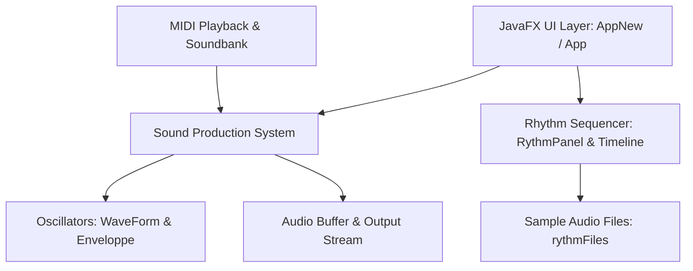

# MyLittleSynth

[](https://openjdk.org/)
[](https://openjfx.io/)
[](https://gradle.org/)
[](LICENSE)

> An open-source software synthesizer, virtual keyboard, and sample-based rhythm sequencer built with Java and JavaFX.

---

## Overview

**MyLittleSynth** is a modular audio application combining a virtual synthesizer, interactive keyboard, sample-based rhythm box, and MIDI tooling in a unified Java and JavaFX desktop environment. It allows musicians, sound designers, and developers to generate polyphonic tones across multiple wave shapes, program rhythm loops, record audio samples, inspect waveforms, and read MIDI soundbanks.

---

## Features

### 🎹 Software Synthesizer & Oscillators
- **Multi-Waveform Generation:** Built-in oscillators supporting standard waveforms including **Sine**, **Square / Rectangular**, **Triangle**, and **Sawtooth**.
- **Envelope Shaping & Modulation:** ADSR (Attack, Decay, Sustain, Release) envelope filters to sculpt note dynamics and durations.
- **Octave & Pitch Controls:** Multi-octave transposition sliders and dynamic tone mappings.
- **Volume & Gain Adjustments:** Dedicated master volume attenuation and audio buffer scaling.

### 🎛️ Virtual Keyboard & Controls
- **Interactive UI Keyboard:** On-screen keys responding to mouse clicks and multi-touch interactions.
- **Computer Keyboard Bindings:** Quick trigger bindings mapped to standard QWERTY/AZERTY keys for live performance.
- **Tone & Note Selection:** Real-time note triggers with polyphonic state tracking.

### 🥁 Rhythm Box & Loop Sequencer
- **Pattern & Timeline Sequencer:** Timeline-based grid (`Timeline`, `RythmPanel`, `RythmModel`) for orchestrating complex rhythm arrangements.
- **Sample Audio Playback:** Multi-track audio file loading and playback supporting WAV, MP3, and M4A formats.
- **Loop Timing & Repeats:** Configurable loop timers (`LoopTimer`, `LoopProgress`, `PlayListRepeat`) for synchronized playback loops.
- **Bundled Rhythm Packs:** Includes built-in rhythm and instrument sample libraries (`rythmFiles/`).

### 🎵 MIDI, Recording & Audio Tools
- **MIDI Playback & Soundbanks:** Integrated MIDI soundbank reader (`MidiSoundbankReader`) and file player (`MidiPlayback`).
- **Microphone & Sample Recording:** Built-in microphone input capture (`Mic`, `Rec`) for live sampling and sample replay.
- **Real-Time Visualization:** Audio graphing and 3D wave visualization (`AudioGraph`, `AudioViewer`, `Spirale3D`) for inspecting waveform dynamics.

---

## Prerequisites

Before building and running MyLittleSynth, ensure your system meets the following requirements:

- **Java Development Kit (JDK):** Version 19 or higher
- **Gradle:** Version 7.0 or higher (or use a system Gradle installation)
- **JavaFX SDK:** JavaFX 16+ runtime components (`javafx.controls`, `javafx.fxml`, `javafx.media`, `javafx.graphics`)

---

## Quick Start & Execution

### 1. Build the Project
Compile the Java source code and assemble archive packages:
```bash
gradle build
```

### 2. Launch the Application
You can run the modern GUI or the classic interface via Gradle tasks:

- **Launch Modern Interface:**
  ```bash
  gradle runNewAppGui
  ```

- **Launch Classic Interface:**
  ```bash
  gradle runAppGui
  ```

### 3. Platform Launch Scripts
Convenience scripts are provided in the repository root:

- **Windows:**
  ```cmd
  launch.bat
  ```

- **Linux / macOS:**
  ```bash
  chmod +x launch.sh
  ./launch.sh
  ```

---

## Architecture & Project Structure

### High-Level Architecture


### Directory Layout
```
MyLittleSynth/
├── src/main/java/one/empty3/apps/mylittlesynth/
│   ├── App.java                 # Classic JavaFX application entry point & controls
│   ├── AppNew.java              # Modern tabbed JavaFX application interface
│   ├── SoundProductionSystem.java # Core audio synthesis and sample generation engine
│   ├── Player.java / PlayerSwing.java # Audio playback dispatcher and state management
│   ├── Note.java / Note2.java   # Tone representation and waveform binding
│   ├── Enveloppe.java           # ADSR envelope and Bézier curve shaping
│   ├── AudioGraph.java          # Real-time audio signal visualizer
│   ├── microphone/              # Audio recording and microphone input (Mic.java)
│   └── rythms/                  # Rhythm sequencer, timeline, and playlist management
│       ├── RythmPanel.java      # Rhythm box sequencer UI
│       ├── Timeline.java        # Multi-track pattern timeline
│       ├── LoopTimer.java       # Loop and repeat timer controllers
│       └── MidiSoundbankReader.java # MIDI soundbank reader
├── rythmFiles/                  # Bundled rhythm audio samples and sound files
├── lib/                         # External libraries and local JavaFX SDK modules
├── build.gradle                 # Gradle build script and dependency configurations
├── launch.bat / launch.sh       # Platform-specific launcher scripts
└── LICENSE                      # GNU General Public License v2 (GPL-2.0)
```

---

## License

This project is licensed under the **GNU General Public License v2 (GPL-2.0)**. See the [LICENSE](LICENSE) file for the full license terms.
